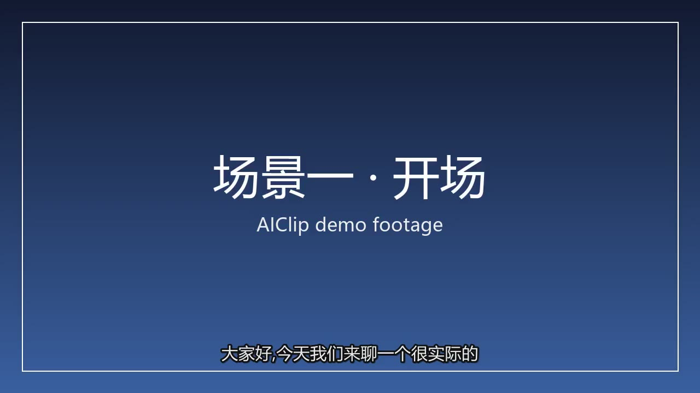

# AIClip

**A fully local AI video editing pipeline: transcribe → cut dead air → subtitles → vertical clips → footage search. Offline, no API keys.**

`14/14 command self-tests passing` · `GPU ASR 6.3× faster than CPU` · `MIT`



---

## Table of contents

- [Features](#features)
- [Quick start](#quick-start)
- [Command reference](#command-reference)
- [Three typical workflows](#three-typical-workflows)
- [Outputs](#outputs)
- [How it works](#how-it-works)
- [Performance](#performance)
- [Tuning](#tuning)
- [Limits](#limits)
- [Project layout](#project-layout)
- [License](#license)

## Features

| Capability | Description |
|---|---|
| **Talking-head rough cut** | Word-level timestamps; removes pauses, breaths and filler words; subtitles re-timed to the new cut |
| **Energy rough cut** | Cuts by loudness for footage with no speech (travel, scenery, B-roll) |
| **Full-length subtitles** | SRT / VTT / ASS, burned in or muxed as soft subs |
| **Vertical reframing** | `pad` (blurred background) / `crop` (center crop) / `fit` (letterbox) |
| **Long video → shorts** | Picks N windows by speech density, exports 9:16 clips with burned captions |
| **Semantic footage search** | Shot detection + CLIP embeddings; query with plain natural language |
| **Assemble from results** | Multi-source render of matched shots into one timeline |
| **Offline dubbing** | Script → Windows SAPI TTS → replaces the original audio |
| **Beat detection** | BPM + beat timestamps for rhythmic cutting |
| **Web UI** | Five-tab Gradio interface covering every feature |

- No network calls, no uploads, no API keys
- Audio is decoded to 16k float32 with ffmpeg before ASR, sidestepping PyAV version conflicts
- Model downloads via hf-mirror, written as `.part` and renamed only when complete
- All clips normalized before concat, so joins are clean and never corrupt

## Quick start

### 1. Requirements

- Windows 10/11 (the dubbing feature uses Windows SAPI)
- Python 3.10+ (tested on 3.13)
- FFmpeg on `PATH`
- Optional: an NVIDIA GPU (any CUDA 12.x driver; no Toolkit install needed)

### 2. Install

```powershell
# Reuses the torch / opencv / faster-whisper / librosa already on the machine,
# installs only what is missing from the Aliyun mirror, and installs the CUDA
# build of torch from the local wheels/ folder (no re-download).
powershell -ExecutionPolicy Bypass -File .\setup_env.ps1
```

On first run the models are fetched automatically (Whisper small 461 MB + CLIP 577 MB,
through hf-mirror, resumable).

### 3. Run

```powershell
# Web UI (recommended)
.\启动界面.cmd

# CLI
.\aiclip.cmd doctor
.\aiclip.cmd pipeline your-footage.mp4 --n 3
```

### 4. Self-test

```powershell
.\.venv\Scripts\python.exe tools\selftest.py
```

## Command reference

```
aiclip <command> [args]
```

| Command | Purpose | Key flags |
|---|---|---|
| `doctor` | Environment check (ffmpeg / torch / CUDA / deps) | — |
| `probe <file>` | Media info | — |
| `transcribe <file>` | Transcribe to SRT/VTT/JSON | `--model --lang --device` |
| `rough <file>` | Talking-head rough cut + subtitles | `--max-gap --pad --keep-fillers --no-burn --mode asr\|energy` |
| `subs <file>` | Full-length subtitles | `--soft` (mux instead of burn) `--device` |
| `shorts <file>` | Long video → vertical clips | `--n --length --vertical crop\|pad\|fit` |
| `vertical <file>` | Vertical reframing | `--mode crop\|pad\|fit` |
| `beats <file>` | BPM / beat detection | `--out beats.json` |
| `index <dir>` | Build a footage index | `--threshold --device` |
| `search <idx> <query>` | Natural-language search | `--topk` |
| `assemble <picks.json>` | Assemble matched shots | `--vertical` |
| `dub <video> <script.txt>` | Replace audio with TTS narration | `--voice --rate --gap` |
| `voices` | List installed TTS voices | — |
| `pipeline <file>` | Rough cut + shorts in one go | `--n --length --outdir` |
| `ui` | Web interface | `--port --host --share` |

## Three typical workflows

```powershell
# A. Talking head, one command
.\aiclip.cmd pipeline talk.mp4 --n 3 --length 45

# B. Footage library → search → assemble
.\aiclip.cmd index D:\footage --out out\idx
.\aiclip.cmd search out\idx "rainy street pedestrians empty shot" --topk 10
.\aiclip.cmd assemble out\picks.json --vertical pad

# C. Re-versioning: rewrite the script, re-dub
.\aiclip.cmd dub video.mp4 script.txt --voice "Microsoft Huihui Desktop"
```

## Outputs

```
out/rough/
  rough_sub.mp4        final cut with burned subtitles
  rough.mp4            same cut, no subtitles
  rough.srt / .ass     subtitles re-timed to the new timeline
  edl.json             edit decision list (in/out per segment, reusable)
  transcript.json      full transcript with word-level timestamps
  report.json          duration before/after, cut ratio, segment count
out/shorts/clip_01/
  clip.mp4             horizontal clip
  vertical.mp4         9:16 clip
  final.mp4            captioned deliverable
  sub.srt / sub.ass
out/idx/
  meta.json            shot list (video / start / end / keyframe)
  emb.npy              CLIP embeddings (512-d)
  frames/*.jpg         keyframes
```

## How it works

```
footage ─┬─ ffmpeg decode ─→ 16k float32 ─→ faster-whisper ─→ word timestamps
         │                                                       │
         │                              ┌────────────────────────┘
         │                              ↓
         │                    group words (gap > max_gap)
         │                    drop fillers → pad → merge overlaps
         │                              ↓
         │                       EDL (in/out per segment)
         │                              ↓
         └─ ffmpeg trim ×N ─→ normalize ─→ concat ─→ burn subs ─→ deliver

Visual side: PySceneDetect shots → keyframes → open_clip embeddings →
             cosine similarity against a text query → timeline NMS
Subtitle side: new time = old time − accumulated offset;
               line breaks on punctuation / char count / duration
```

## Performance

Test footage: 48.9 s Chinese talking head (`demo/demo.mp4`), RTX 5070 Ti Laptop, 11.9 GB.

| Item | CPU | GPU | Speedup |
|---|---|---|---|
| faster-whisper small transcription | 11.02 s (RTF 0.225) | **1.75 s (RTF 0.036)** | **6.3×** |
| Rough cut, end to end | — | 9.8 s | — |
| Full pipeline (rough cut + 2 shorts + captions) | — | 24.5 s | — |
| Peak VRAM | — | 841 MiB | — |

Command self-test (`tools/selftest.py`): **14/14 passing** — doctor 17.4 s, transcribe 6.5 s,
rough 9.8 s, shorts 24.2 s, index 15.3 s, pipeline 15.2 s (including process start and model load).

## Tuning

| Flag | Default | Larger means |
|---|---|---|
| `--max-gap` | 0.55 | Keep longer pauses; looser cut |
| `--pad` | 0.08 | More breathing room around each segment |
| `--keep-fillers` | off | Keep "um", "uh", "you know" |
| `--model` | small | medium / large-v3: more accurate, slower (large-v3 float16 fits in 12 GB) |
| `index --threshold` | 27 | Lower = more, shorter shots |
| `shorts --length` | 45 | Longer individual clips |

## Limits

- **It cuts speech, not pictures.** Silent footage is only semi-automatic via `index` + `search`.
- **It cannot tell which take is better.** It scores similarity and speech density, not emotion,
  humor or narrative value.
- **It does not rewrite.** Fillers are removed; slips of the tongue and repeated sentences are not.
- **Every output is a rough cut.** Final cut decisions stay with a human.
- The `small` model occasionally drifts from Simplified to Traditional Chinese; use
  `--model medium` for delivery work.

## Project layout

```
aiclip/
  ff.py        ffmpeg wrappers (trim / concat / vertical / subtitle burn)
  text.py      SRT / ASS / VTT
  asr.py       whisper transcription + EDL + subtitle re-timing
  audio.py     silence detection / beats / speech density
  vision.py    shot detection + CLIP index and search
  edit.py      EDL rendering
  pipeline.py  product pipelines (rough cut / shorts / search / subs / dubbing)
  tts.py       offline Windows SAPI dubbing
  models.py    mirror downloads (hf-mirror, resume, .ready validation)
  cli.py       command line
  ui.py        Gradio interface
tools/
  make_demo.py  build demo footage (TTS + three scenes)
  selftest.py   full command self-test
  bench2.py     warm CPU vs GPU benchmark
  licenses.py   dependency license report
```

## License

**MIT** — see [LICENSE](LICENSE).

Third-party components (PyTorch BSD-3, faster-whisper MIT, PySceneDetect BSD-3, open_clip MIT,
Gradio Apache-2.0, FFmpeg LGPL/GPL) and model weights (Whisper and CLIP, both MIT) are documented
in [THIRD_PARTY.md](THIRD_PARTY.md).

> FFmpeg is invoked as an external process and is not redistributed with this repository. If you
> ship a bundle, verify the license of the FFmpeg build you use.
