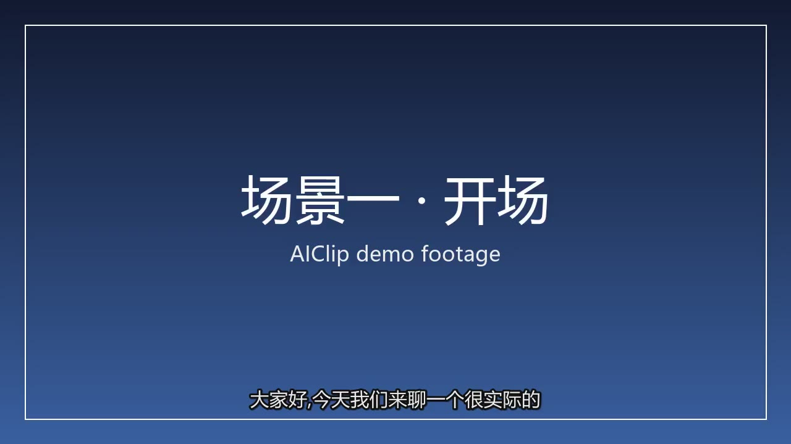

# AIClip

**本地 AI 视频剪辑流水线：转写 → 剪气口 → 字幕 → 竖屏切片 → 素材检索。全离线，不调 API。**

`14/14 命令自检通过` · `GPU 转写 6.3× CPU` · `Apache-2.0`



---

## 目录

- [特性](#特性)
- [快速开始](#快速开始)
- [命令参考](#命令参考)
- [三种典型工作流](#三种典型工作流)
- [输出物](#输出物)
- [原理](#原理)
- [性能](#性能)
- [调参](#调参)
- [能力边界](#能力边界)
- [目录结构](#目录结构)
- [许可](#许可)

## 特性

| 能力 | 说明 |
|---|---|
| **口播粗剪** | 词级时间戳定位，剪掉停顿/气口/口头禅，字幕时间轴自动重排 |
| **能量粗剪** | 无语音素材按音量切（风景、旅拍、空镜） |
| **整片字幕** | SRT / VTT / ASS，可烧录或软字幕封装 |
| **竖屏重构** | pad（模糊填充）/ crop（中心裁切）/ fit（黑边） |
| **长视频切片** | 按语音信息密度自动挑 N 个窗口，直出竖屏带字幕 |
| **素材语义检索** | 镜头切分 + CLIP 向量，用中文句子找素材 |
| **检索拼片** | 按命中结果多源拼接成片 |
| **离线配音** | 文稿 → Windows SAPI TTS → 替换原声 |
| **节拍检测** | BPM + 节拍点，做卡点 |
| **网页界面** | Gradio 五标签页，全部功能可视化 |

- 不联网、不上传、不需要任何 API Key
- 音频自己解码成 16k float32 再喂模型，绕开 PyAV 版本坑
- 模型下载走 hf-mirror，先写 `.part` 再改名，半包永不被误用
- 输出统一规格，concat 无损拼接不花屏

## 快速开始

### 1. 环境要求

- Windows 10/11（配音功能依赖 Windows SAPI）
- Python 3.10+（实测 3.13）
- FFmpeg 在 PATH
- 可选：NVIDIA GPU（CUDA 12.x 驱动即可，无需装 Toolkit）

### 2. 安装

```powershell
# 复用本机已有的 torch / opencv / faster-whisper / librosa，只补缺失依赖
# 走阿里云源；CUDA 版 torch 从本地 wheels/ 安装，不联网下载
powershell -ExecutionPolicy Bypass -File .\setup_env.ps1
```

首次运行会自动下载模型（Whisper small 461MB + CLIP 577MB，走 hf-mirror，支持断点续传）。

### 3. 跑起来

```powershell
# 网页界面（推荐）
.\启动界面.cmd

# 命令行
.\aiclip.cmd doctor
.\aiclip.cmd pipeline 你的素材.mp4 --n 3
```

### 4. 自检

```powershell
.\.venv\Scripts\python.exe tools\selftest.py
```

## 命令参考

```
aiclip <command> [args]
```

| 命令 | 作用 | 关键参数 |
|---|---|---|
| `doctor` | 环境体检（ffmpeg / torch / CUDA / 依赖版本） | — |
| `probe <file>` | 媒体信息 | — |
| `transcribe <file>` | 转写并输出 SRT/VTT/JSON | `--model --lang --device` |
| `rough <file>` | 口播粗剪 + 字幕 | `--max-gap --pad --keep-fillers --no-burn --mode asr\|energy` |
| `subs <file>` | 整片字幕 | `--soft`（软字幕）`--device` |
| `shorts <file>` | 长视频→竖屏切片 | `--n --length --vertical crop\|pad\|fit` |
| `vertical <file>` | 竖屏重构 | `--mode crop\|pad\|fit` |
| `beats <file>` | BPM/节拍检测 | `--out beats.json` |
| `index <dir>` | 素材建索引 | `--threshold --device` |
| `search <idx> <query>` | 自然语言检索 | `--topk` |
| `assemble <picks.json>` | 按命中拼片 | `--vertical` |
| `dub <video> <script.txt>` | 文稿配音替换原声 | `--voice --rate --gap` |
| `voices` | 列出系统音色 | — |
| `pipeline <file>` | 粗剪 + 切片一条龙 | `--n --length --outdir` |
| `ui` | 网页界面 | `--port --host --share` |

## 三种典型工作流

```powershell
# A. 口播一条龙
.\aiclip.cmd pipeline 口播.mp4 --n 3 --length 45

# B. 素材库 → 检索 → 拼片
.\aiclip.cmd index D:\footage --out out\idx
.\aiclip.cmd search out\idx "雨天 街道 行人 空镜" --topk 10
.\aiclip.cmd assemble out\picks.json --vertical pad

# C. 出海改名：改稿 → 配音
.\aiclip.cmd dub 视频.mp4 文稿.txt --voice "Microsoft Huihui Desktop"
```

## 输出物

```
out/rough/
  rough_sub.mp4        成片（已烧字幕）
  rough.mp4            未烧字幕版
  rough.srt / .ass     时间轴已重排的字幕
  edl.json             剪辑决策表（每段起止，可复用/回改）
  transcript.json      全文转写（含词级时间戳）
  report.json          时长对比、剪辑率、段数
out/shorts/clip_01/
  clip.mp4             横屏切片
  vertical.mp4         竖屏切片
  final.mp4            烧字幕成品
  sub.srt / sub.ass
out/idx/
  meta.json            镜头清单（视频/起止/关键帧）
  emb.npy              CLIP 向量（512 维）
  frames/*.jpg         关键帧
```

## 原理

```
素材 ─┬─ ffmpeg 解音轨 ─→ 16k float32 ─→ faster-whisper ─→ 词级时间戳
      │                                                        │
      │                                    ┌───────────────────┘
      │                                    ↓
      │                        语音块合并（gap > max_gap）
      │                        去口头禅 → 前后 pad → 重叠合并
      │                                    ↓
      │                            EDL（每段起止时间）
      │                                    ↓
      └─ ffmpeg trim ×N ─→ 统一规格 ─→ concat ─→ 烧字幕 ─→ 成片

画面侧：PySceneDetect 切镜头 → 关键帧 → open_clip 向量 → 文本向量余弦相似度 → 时间轴 NMS
字幕侧：剪辑后时间 = 原时间 − 已累计偏移；按标点/字数/时长三条件断行
```

## 性能

测试素材：48.9 秒中文口播（`demo/demo.mp4`），RTX 5070 Ti Laptop 11.9GB。

| 项 | CPU | GPU | 倍率 |
|---|---|---|---|
| faster-whisper small 转写 | 11.02s（RTF 0.225） | **1.75s（RTF 0.036）** | **6.3×** |
| 口播粗剪端到端 | — | 9.8s | — |
| 一条龙（粗剪 + 2 切片 + 字幕） | — | 24.5s | — |
| 运行期显存峰值 | — | 841 MiB | — |

命令自检（`tools/selftest.py`）：**14/14 通过**，doctor 17.4s / transcribe 6.5s / rough 9.8s /
shorts 24.2s / index 15.3s / pipeline 15.2s（含进程启动与模型加载）。

## 调参

| 参数 | 默认 | 调大的效果 |
|---|---|---|
| `--max-gap` | 0.55 | 保留更长停顿，剪辑更"松" |
| `--pad` | 0.08 | 每段前后留白更多，语感更自然 |
| `--keep-fillers` | 关 | 保留"嗯/那个/就是" |
| `--model` | small | medium / large-v3 更准更慢（12GB 显存可跑 large-v3 float16） |
| `index --threshold` | 27 | 越小切得越碎，镜头更细 |
| `shorts --length` | 45 | 单条切片更长 |

## 能力边界

- **剪的是"话"，不是"画面"**：无语音素材靠 `index` + `search` 半自动
- **不懂"哪段更好"**：只算相似度与信息密度，判断不了情绪、笑点、叙事价值
- **不改写内容**：口头禅会剪，口误/结巴/重复句不重写
- **产出是初剪**：定剪永远在人手上
- small 模型中文偶尔简体漂繁体，正式交付建议 `--model medium`

## 目录结构

```
aiclip/
  ff.py        ffmpeg 封装（trim / concat / 竖屏 / 字幕烧录）
  text.py      SRT / ASS / VTT
  asr.py       whisper 转写 + EDL + 字幕重排
  audio.py     静音检测 / 节拍 / 语音密度
  vision.py    镜头切分 + CLIP 索引检索
  edit.py      EDL 渲染
  pipeline.py  成品流水线（粗剪/切片/检索/字幕/配音）
  tts.py       Windows SAPI 离线配音
  models.py    镜像下载（hf-mirror，断点续传 + .ready 校验）
  cli.py       命令行
  ui.py        Gradio 界面
tools/
  make_demo.py  生成演示素材（TTS + 三场景）
  selftest.py   全命令自检
  bench2.py     预热后 CPU/GPU 基准
  licenses.py   依赖许可证清单
```

## 许可

本项目采用 **Apache License 2.0**，见 [LICENSE](LICENSE) 与 [NOTICE](NOTICE)。

选它的原因：本项目的依赖全是宽松许可（BSD-3 / MIT / Apache-2.0 / ISC），
而 Apache-2.0 在 MIT 的基础上多给了**明确的专利授权**和**商标不授权**条款，
对公司或商业集成方更清晰；代价是分发时要保留 NOTICE、修改过的文件要标注。

第三方组件（PyTorch BSD-3、faster-whisper MIT、PySceneDetect BSD-3、open_clip MIT、
Gradio Apache-2.0、FFmpeg LGPL/GPL 等）与模型权重（Whisper / CLIP 均 MIT）的许可说明见
[THIRD_PARTY.md](THIRD_PARTY.md)。

> 注意：FFmpeg 仅以子进程方式调用，未随仓库分发；若你要打包分发，请自行确认所用
> FFmpeg 构建的许可条款。Apache-2.0 与 GPLv2 不兼容，若将来要并入 GPLv2 代码需先评估。
